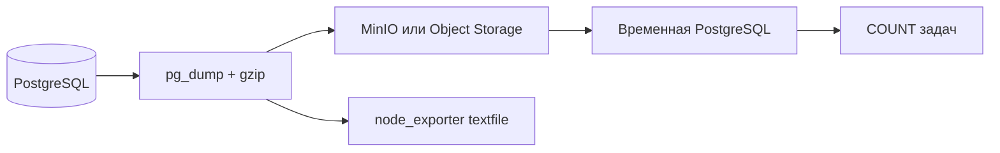

# pg-backup-toolkit

[](https://github.com/nikit0id/pg-backup-toolkit/actions/workflows/ci.yml)

Инструмент сохраняет PostgreSQL приложения portfolio-api в S3 и проверяет восстановление в новом контейнере. Во время проверки он сверяет SHA-256 и число задач, подсчитанное в той же транзакционной снимковой версии, которую читает pg_dump.



## Запуск за три команды

На Linux нужны Docker Compose, Git, Python 3.12 с venv и OpenSSL.

```bash
git clone https://github.com/nikit0id/pg-backup-toolkit && cd pg-backup-toolkit
scripts/init-env
scripts/demo
```

Демо создаёт тестовые задачи, складывает архив в MinIO и выводит строку restore verified с фактическим числом строк и SHA-256. Порты доступны на loopback. Для остановки выполните docker compose down.
Для локального MinIO используется сборка coollabsio из архивного релиза проекта, закреплённая по digest.

## Что внутри

- Для рабочей базы запускайте toolkit.py backup с клиентом pg_dump той же основной версии и переменными PGHOST, PGPORT, PGUSER, PGPASSWORD, PGDATABASE. Для S3 задайте AWS_ACCESS_KEY_ID, AWS_SECRET_ACCESS_KEY, AWS_DEFAULT_REGION, S3_BUCKET, S3_PREFIX и при необходимости S3_ENDPOINT_URL. Бакет создаёт оператор.
- Завершённую копию обозначает JSON-манифест. Ротация сохраняет последний архив за каждый из 7 последних доступных дней, 4 ISO-недель и 3 месяцев. Один архив может покрывать несколько периодов. Выделите свой S3_PREFIX для каждой базы.
- toolkit.py restore выбирает последний завершённый архив. Проверочная PostgreSQL изолирована от сети и удаляется после контрольного запроса.
- Для расписания установите проект в /opt/pg-backup-toolkit и зависимости в .venv. Заполните /etc/portfolio/pg-backup.env с правами 0600. Скопируйте systemd/portfolio-pg-* в /etc/systemd/system, выполните systemctl daemon-reload и включите `systemctl enable --now portfolio-pg-backup.timer portfolio-pg-restore.timer`. Требуется доступ к Docker для проверки восстановления.
- METRICS_DIR должен указывать на каталог textfile collector node_exporter. Опциональные TELEGRAM_BOT_TOKEN и TELEGRAM_CHAT_ID включают уведомления. Время бэкапа и восстановления — по часовому поясу хоста.

## Что я узнал

- Подсчёт строк вне снимка даёт ложную ошибку, если во время резервирования появилась новая задача.
- Манифест записывается после загрузки архива. Незавершённая загрузка не попадёт в список готовых копий.
- Контрольная сумма проверяет байты. Только восстановление с выполнением SQL проверяет, что архив пригоден для запуска базы.

## Что бы сделал дальше

- Хранить отдельную копию в другом аккаунте с защитой от удаления.
- Добавить восстановление на момент времени по архиву WAL.
